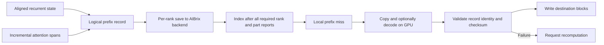

# Restoring a hybrid prefix: state, spans, and the cost of moving bytes

Hybrid inference combines recurrent state with full-attention KV blocks.
Reusing a prefix therefore needs both the state at a valid resume boundary
and all attention spans leading to that boundary. Saving ordinary attention
blocks alone does not establish a correct hybrid resume.

## Representation and execution

The current integration stores a recurrent-state object and an attention-span
object per boundary and tensor-parallel rank. New turns can depend on earlier
spans instead of rewriting the whole prefix. The scheduler exposes a hit only
when the state and its complete span chain have been reported by all ranks.
The worker supports IDENTITY and optional GPU ANS records. Chunked transfers
and bounded ANS frames limit staging work. Asynchronous saves are dropped
when staging slots are busy; this avoids waiting for every save in inference.

MEMORY is a process-local backend. Its records do not survive worker restart
and are not a distributed cache. Other backends need their own correctness,
latency, persistence and failure evidence.

## Two different benefits

Prefix reuse avoids recomputing part of prefill. Compression reduces bytes
stored and moved. These require different baselines:

| Question | Comparison | Evidence |
| --- | --- | --- |
| Does external reuse help? | Recompute vs IDENTITY restore | Client TTFT and verified external load |
| Does compression help? | IDENTITY vs ANS restore | Actual stored/transferred bytes, codec cost and TTFT |
| Is the record lossless? | Source vs restored cache bytes | Bytewise checks, including every required group |
| Is inference correct? | Matched model runs | Output equivalence or a separately justified correctness criterion |

A useful lower bound is `transfer time >= transferred bytes / effective H2D
bandwidth`. If compression reduces bytes by a factor `r`, it cannot by itself
reduce that transfer below `1/r` of its original duration at fixed bandwidth.
End-to-end benefit is smaller when decoding, block writes, queueing, remaining
prefill or other serial work dominates. Compression cannot remove those terms.
Measure per-rank bytes and the slowest required rank, not just an average.

## What has actually been checked

At source `b0b4dbc0`, 63 constructed-tensor checks pass on H800 with Torch
2.13.0+cu130, CUDA 13.0 and vLLM 0.30.0 in the runtime image. They include GPU
ANS round trips, inference-mode saves, corruption rejection, layout validation,
incremental dependency logic and CPU operation without CUDA stream entry.

This is record-level evidence. Historical whole-model acceptance reports FAIL:
per-rank verification is incomplete and external-resume tokens differ from
local-prefix-hit tokens. The cause has not been established. Historical
performance observations also span multiple source builds, so this release
makes no model-support or speedup guarantee. No model weights, request traces,
video data or internal experiment logs are included in this repository.

## Reproduce and contribute

Start with the CPU command in the repository README, then run the same four
test files on CUDA with the optional nvCOMP runtime available. For model-level
experiments, record the exact code, image and model revisions; separate
recompute, local prefix hit, external restore and failure fallback. Preserve
raw observations privately and publish only data you have permission to share.

The benchmark runner exits on launch, readiness, request, acceptance or analysis
failure; it removes only the container it successfully created. Read the
connector guide before running it: it is an environment-specific starting
point, not a portable compatibility test for every hybrid model.

Upstream contributions start with small independently tested backend contracts.
The full connector remains experimental while model correctness is investigated.
